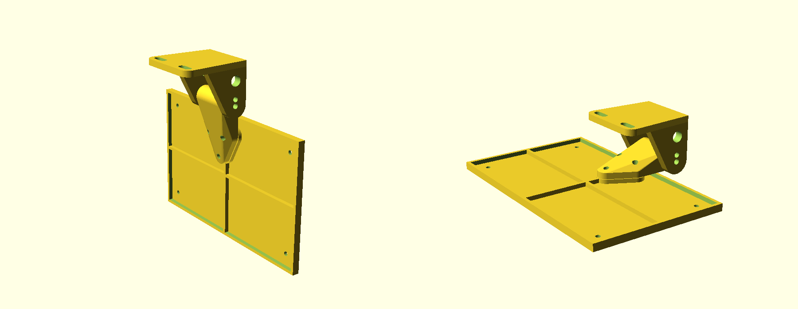

# Support de plaque rétractable – Stark Varg EX/SM

Inspiré du *retractable plateholder* FL Specialparts (vendu par Movetronix) :
- un support plat se visse sous le feu arrière ;
- deux joues portent l'axe ;
- un bras pivotant tient la plaque par 3 vis en triangle.

La plaque passe de **déployée (0°)** à **repliée à plat sous le garde-boue (90°)**, avec un cran à chaque position.

| Pièce | Rôle |
|---|---|
| `support_fixe.stl` | Se fixe sous le feu arrière par 2 lumières M6 (entraxe réglable de 30 à 50 mm). Les joues ont des trous Ø10,5 pour des clignotants à tige Ø10. |
| `bras.stl` | Pivote entre les joues et porte la plaque. |
| `porte_plaque.stl` | Dos de plaque 210 × 130 mm (format moto FR), à boulonner sur le bras. 4 trous Ø4,5 pour riveter la plaque. |
| `support_plaque_pliable.scad` | Modèle paramétrique (OpenSCAD ou Parametric Model Maker de MakerWorld). `part="assemblage"` et `pliage=0..90` affichent l'aperçu. |

## Quincaillerie
- Vis M5 × 70, 2 rondelles et 1 écrou nylstop pour l'axe. Le serrage règle la friction.
- 1 piston à bille M6 (~10 mm), vissé directement dans la joue droite (trou Ø5,2). Il donne les crans à 0° et 90°.
- 3 vis M5 × 20 et 3 écrous nylstop pour fixer la plaque au bras, têtes côté plaque.

## Impression (Bambu Lab, sans supports)
- Matière : **PETG ou ASA**.
- 4 parois, 30 % de remplissage gyroïde.
- Orientation :
  - support : face d'appui sur le plateau, joues vers le haut ;
  - bras : à plat ;
  - porte-plaque : face avant sur le plateau.

## À vérifier sur la moto
- Entraxe des points de fixation sous le feu arrière : paramètres `fix_min` et `fix_max`.
- Hauteur de l'axe sous le support (`axe_bas`, 42 mm) et place pour la plaque repliée. Comme pour le modèle du commerce, le garde-boue inférieur devra probablement être découpé.
- L'angle déployé est perpendiculaire au support. Si le dessous du garde-boue est incliné, ajuste `crans` (par ex. `[-15, 90]`).
